# Pretty Fish

One imaginary fish, two ways of seeing: a fine line drawing alongside a painting
of exactly the same fish, with delicate colour, tapered ink strokes and textured
paper.

Pretty Fish combines two MIT-licensed projects by **LingDong Huang**:

- [fishdraw](https://github.com/LingDong-/fishdraw) generates the anatomy, scales,
  fins, facial features and line work.
- [nonflowers](https://github.com/LingDong-/nonflowers) supplies the adapted
  painting primitives: paper, colour interpolation, variable-width polygon
  strokes, Perlin noise, and the `fade` and `wispy` pigment filters.

Nonflowers is originally a standalone plant generator, rather than an installable
painting library. This project extracts its painting routines into a scoped
browser library and adapts its coloured-ribbon approach to fishdraw's body
boundaries. It does not generate a second fish, colour an unrelated silhouette,
or apply an image-generation model.

## Example specimens

[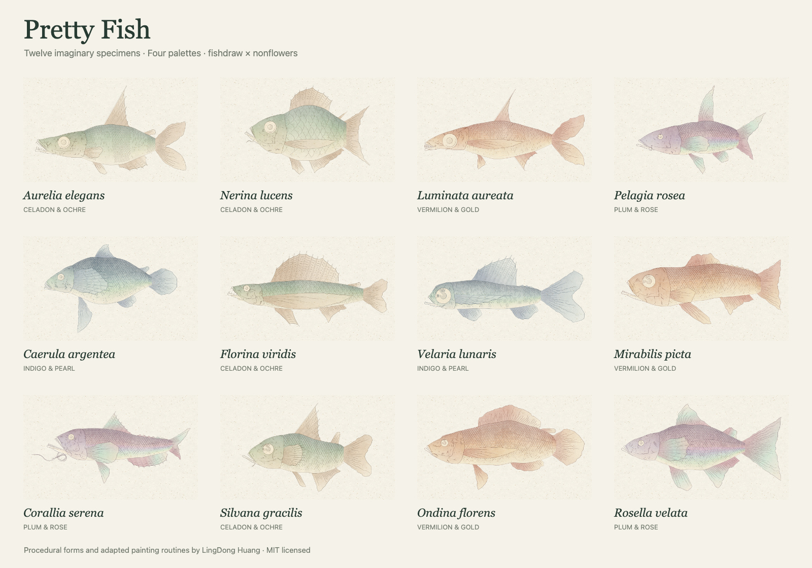](samples/README.md#still-gallery)

[Twelve full-resolution examples and their seeds →](samples/README.md#still-gallery)

## From drawing to painting

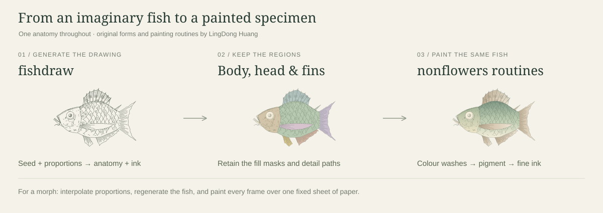

[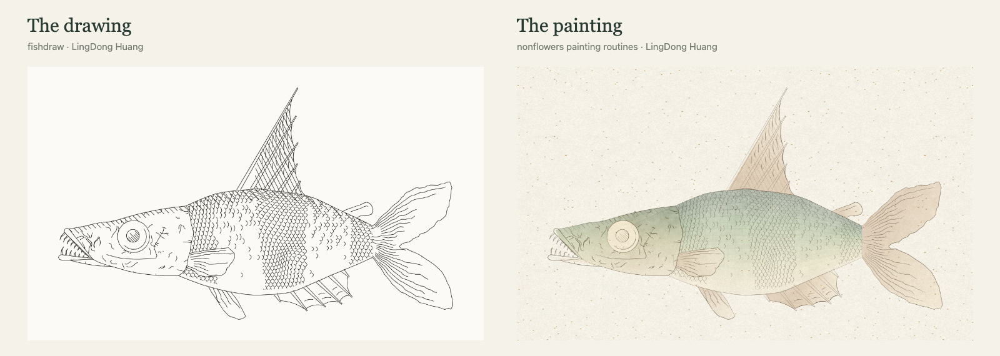](samples/drawing-and-painting.jpg)

## Animated morphs

Eight painted fish changing shape over a stationary sheet of paper. Each loop
regenerates and paints 37 shapes, holds both endpoints, then reverses the same
frames. The drawing seed and style categories stay fixed, following
[FrankFish's morph approach](https://github.com/FrankMarsman/FrankFish/tree/main/samples).

<p>
<a href="samples/animations/celadon-layered.gif">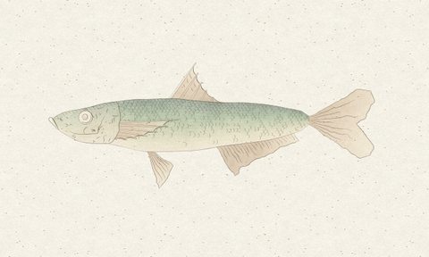</a>
<a href="samples/animations/vermilion-fine.gif">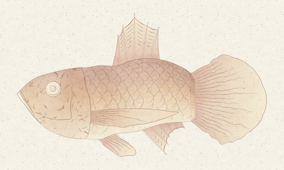</a>
<a href="samples/animations/indigo-crosshatch.gif">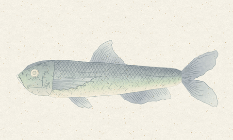</a>
<a href="samples/animations/plum-linear.gif">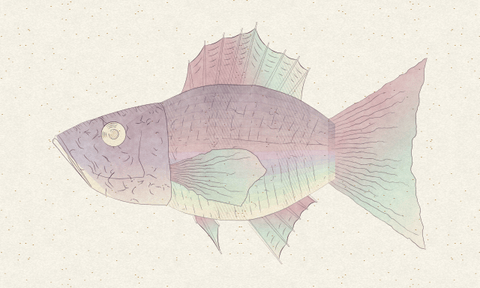</a>
<a href="samples/animations/celadon-fine.gif">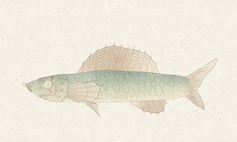</a>
<a href="samples/animations/vermilion-layered.gif">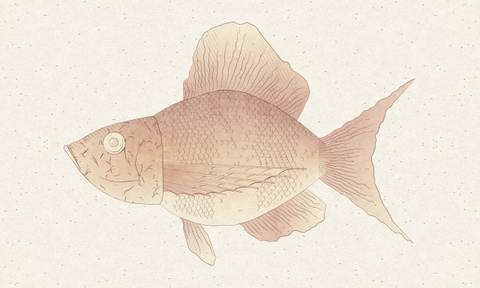</a>
<a href="samples/animations/indigo-linear.gif">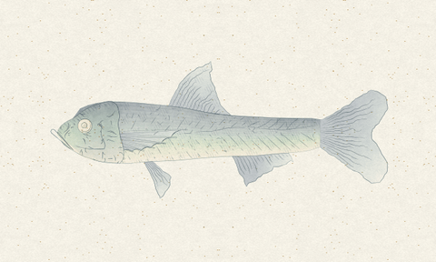</a>
<a href="samples/animations/plum-crosshatch.gif">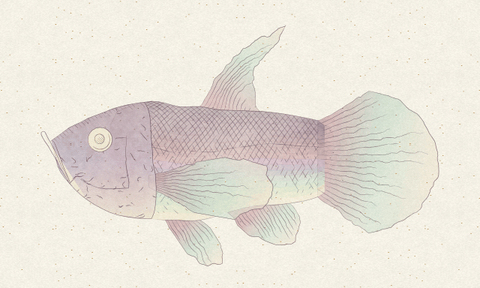</a>
</p>

The paper is generated once per loop, the pigment noise seed and camera stay
fixed, and every frame uses one shared GIF palette with dithering off. Decoded
background pixels and loop seams are checked automatically.

[Animation details, settings and regeneration →](samples/README.md#looped-painted-morphs) · [Verification report](samples/verification.json)

## Try it

Generate a fish, choose one of four palettes, adjust pigment and paper grain,
or turn on **Show regions** to inspect the anatomy. Download the drawing as SVG
or the painting as PNG. **Copy specimen link** saves the seed, palette and texture
settings so the same fish can be revisited. Fine clipping and rasterization
details can differ between browser engines; reproducibility is tested within
the same engine.

The app is a static page with no runtime dependencies, CDN requests, API keys,
accounts or build step. All artwork is generated in the visitor's browser.

## Run locally

Requires Node.js 20 or later for the optional development server and tests.

```sh
npm run dev
```

Open <http://127.0.0.1:4173>. Alternatively serve the `dist/` directory using any
static HTTP server. Use HTTP rather than opening `index.html` directly because
the page uses modules and a web worker.

```sh
npm ci
npm test
npm run check
```

For browser checks, with Google Chrome installed:

```sh
npm run dev
# In a second terminal:
npm run test:browser
```

Set `CHROME_PATH` if Chrome lives somewhere other than the default macOS path.
Browser checks also accept `PRETTY_FISH_URL` to test a deployed page.

## How the two views stay identical

1. A worker creates one seeded fishdraw scene. Its noise table is reset for each
   seed, so results are independent of previously generated fish.
2. The adapted `fish()` exposes the polygons it already computes: body, head,
   dorsal, pectoral, pelvic and anal fins, tail, optional finlets, eye and jaw.
   Head fill geometry is captured separately from the much larger clipping mask.
3. Both views use the same polylines and the same framing transform.
4. The painted body is filled with a ribbon of small quadrilateral colour patches.
   Fin washes run from root to tip; the head has a separate wash and cheek colour.
5. Nonflowers' noise-based `fade` and `wispy` filters vary the pigment. Its `paper()`
   draws the background, and `stroke()` renders the detail paths as tapered ink.
6. Anatomy and painting have separate random state. Changing palette or texture
   never regenerates the fish. Downloads omit the region inspection overlay.

## Source map

| File | Purpose |
| --- | --- |
| `dist/vendor/fishdraw.js` | Vendored fishdraw, isolated and extended to return regions |
| `dist/vendor/nonflowers.js` | Scoped painting primitives extracted from nonflowers |
| `dist/fish-worker.js` | Generates anatomy away from the UI thread |
| `dist/paint.js` | Shared framing, line drawing, anatomical washes and ink rendering |
| `dist/app.js` | Generation, controls, reproducible links and exports |
| `tests/generator.test.cjs` | Original line-art preservation, seed reproducibility and masks |
| `tools/browser-check.cjs` | Browser rendering, controls, downloads and responsive checks |
| `docs/UPSTREAM.md` | Vendored source versions and modifications |
| `samples/` | Still gallery, animated GIFs, parameters and verification report |
| `tools/render-samples.cjs` | Recreates repository examples and fixed-paper morphs |
| `tools/morph.cjs` | Continuous proportions, fixed categories and shared camera |

## Hosting

Publish `dist/` as a static website. The repository includes a GitHub Pages
workflow. In **Settings → Pages → Build and deployment**, select **GitHub Actions**,
then run the **Publish GitHub Pages** workflow. It supports project subpaths such
as `https://<username>.github.io/PrettyFish/` without changing any asset paths.
The `.openai/hosting.json` manifest also supports the connected Sites deployment.

## Credits and license

Original fishdraw: © 2021 Lingdong Huang, MIT.
Original nonflowers: © 2018 Lingdong Huang, MIT.
Pretty Fish integration and page: © 2026 Pretty Fish contributors, MIT.

The original license notices are retained in
[`dist/licenses/`](dist/licenses/), and the page credits and links to both projects.
