# Pretty Fish specimens and morphs

Twelve invented fish and eight loops, generated with LingDong Huang's
[fishdraw](https://github.com/LingDong-/fishdraw) and painting routines adapted
from [nonflowers](https://github.com/LingDong-/nonflowers). All artwork is
procedural. The morphs use the same parameter-interpolation approach as
[FrankFish](https://github.com/FrankMarsman/FrankFish/tree/main/samples).

## Still gallery

Click any image for its full 1200 × 720 version.

<p>
<a href="stills/aurelia-elegans.jpg">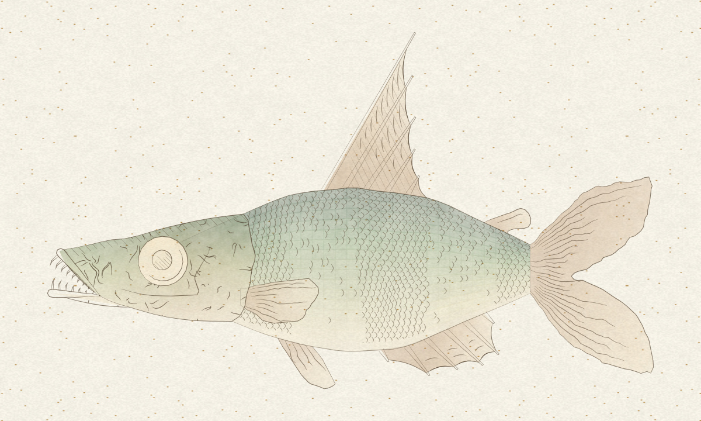</a>
<a href="stills/nerina-lucens.jpg">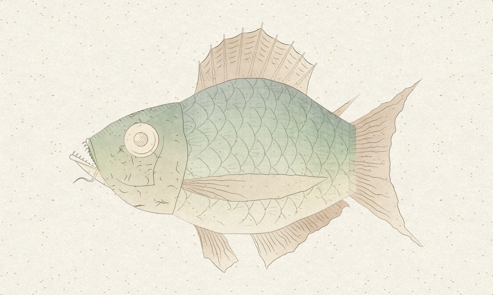</a>
<a href="stills/luminata-aureata.jpg">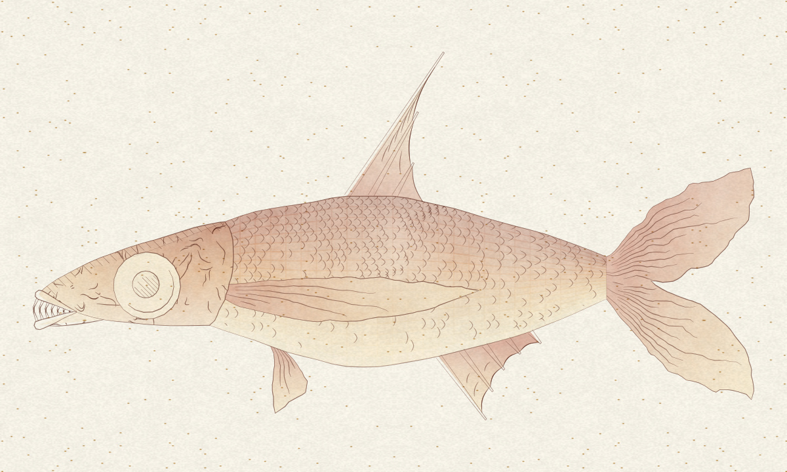</a>
<a href="stills/pelagia-rosea.jpg">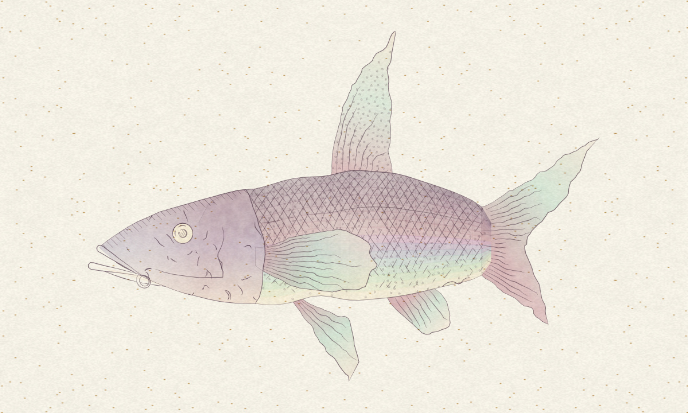</a>
<a href="stills/caerula-argentea.jpg">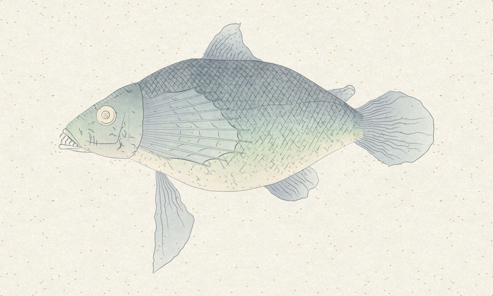</a>
<a href="stills/florina-viridis.jpg">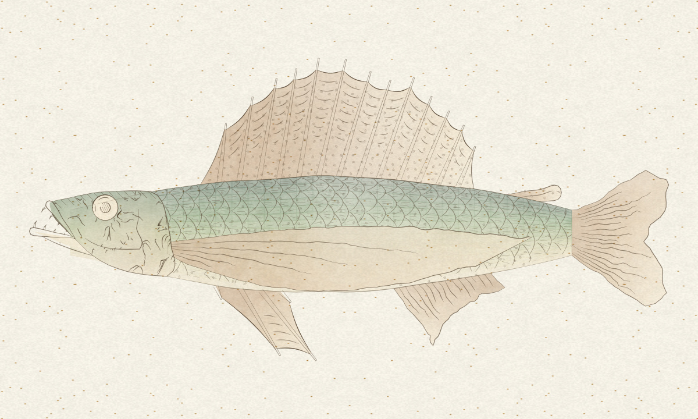</a>
<a href="stills/velaria-lunaris.jpg">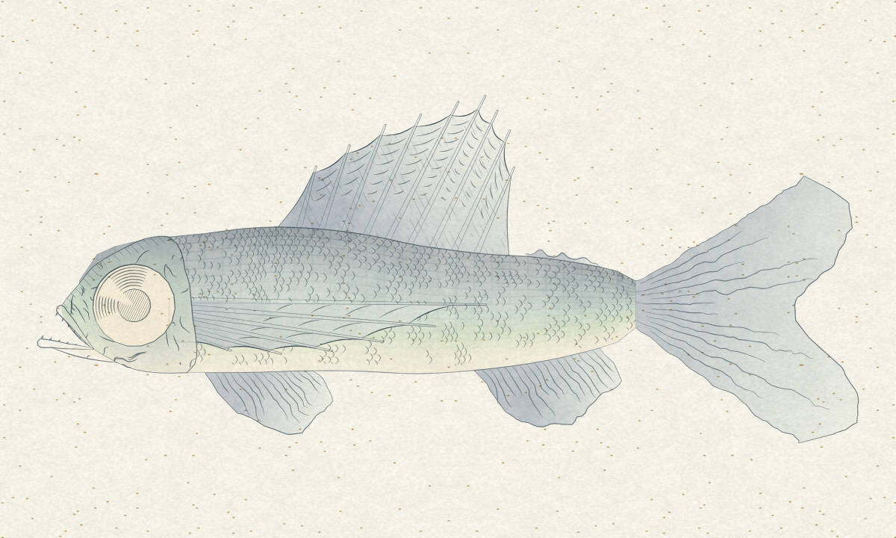</a>
<a href="stills/mirabilis-picta.jpg">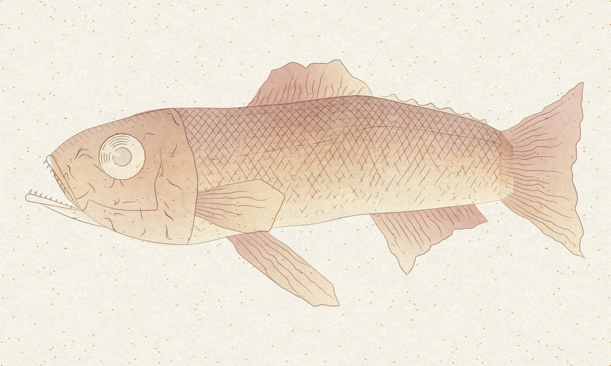</a>
<a href="stills/corallia-serena.jpg">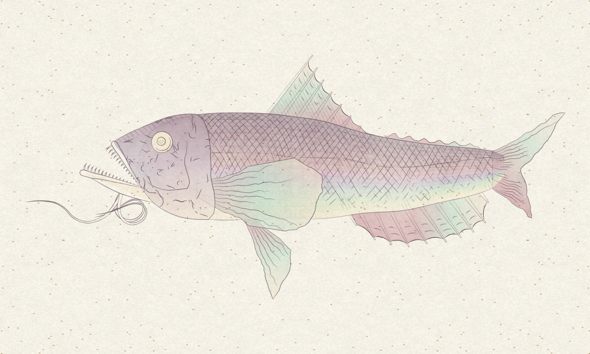</a>
<a href="stills/silvana-gracilis.jpg">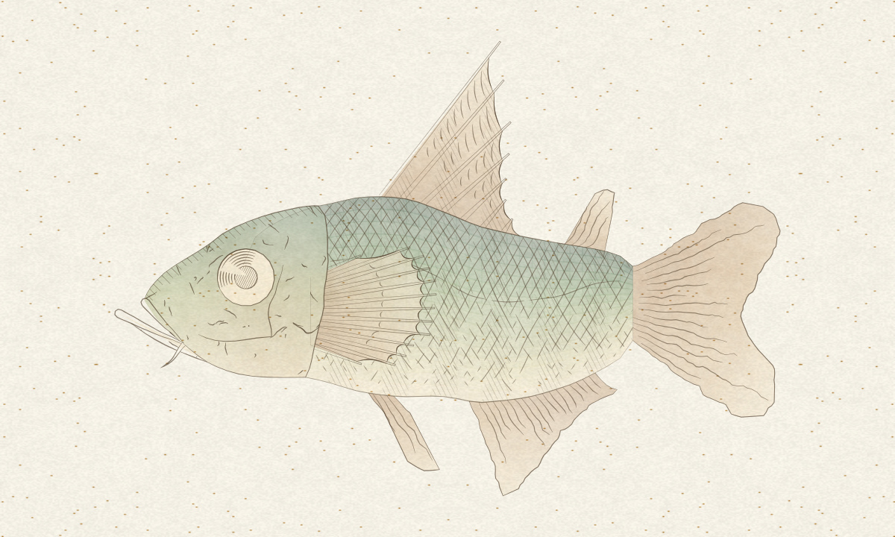</a>
<a href="stills/ondina-florens.jpg">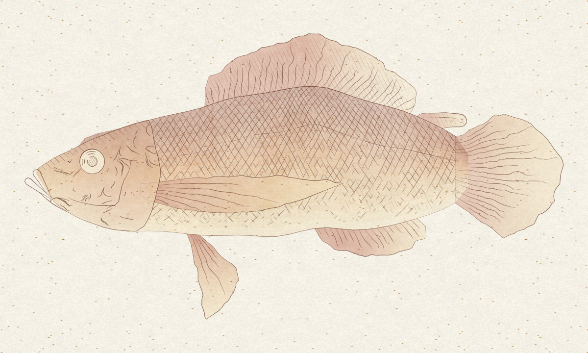</a>
<a href="stills/rosella-velata.jpg">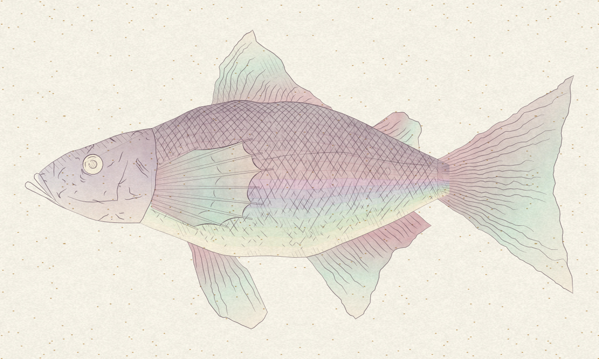</a>
</p>

[Contact sheet](gallery.jpg) · [The same fish in drawing and painting](drawing-and-painting.jpg) · [Exact seeds, parameters and palettes](stills.json)

## Looped painted morphs

Each loop has 37 generated shapes, plays forwards and backwards at 20 fps,
pauses at both endpoints, and lasts 4.6 seconds. The fish changes shape while
its paper stays still. Click an animation to view it separately.

<p>
<a href="animations/celadon-layered.gif">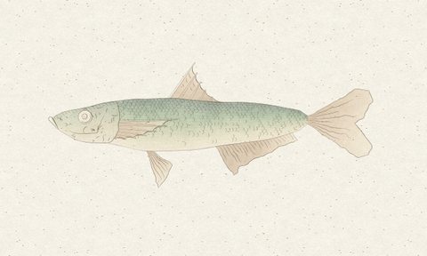</a>
<a href="animations/vermilion-fine.gif">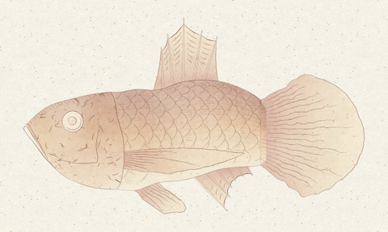</a>
<a href="animations/indigo-crosshatch.gif">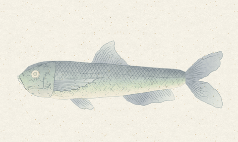</a>
<a href="animations/plum-linear.gif">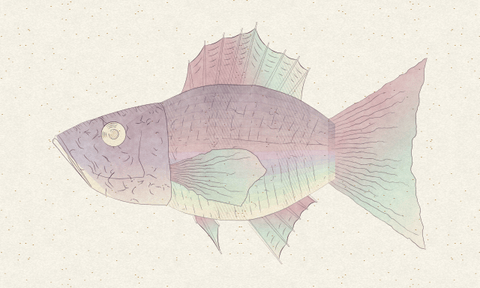</a>
<a href="animations/celadon-fine.gif">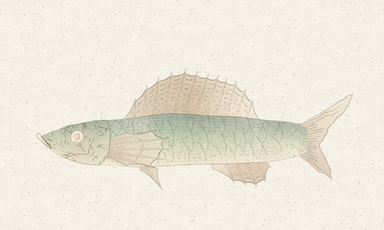</a>
<a href="animations/vermilion-layered.gif">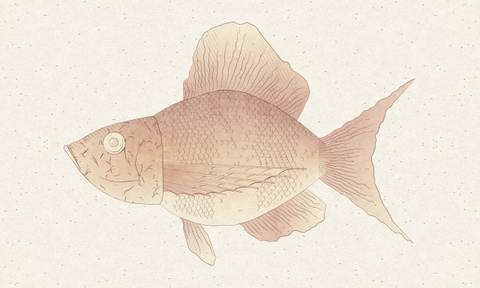</a>
<a href="animations/indigo-linear.gif">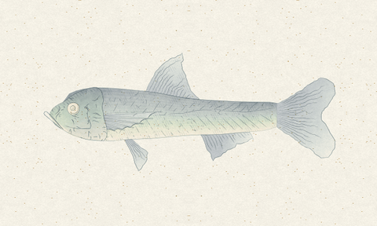</a>
<a href="animations/plum-crosshatch.gif">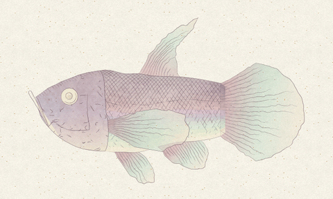</a>
</p>

## Keeping the paper still

- Generate **one paper canvas per loop**, once, from its recorded `paperSeed`.
  Every source frame draws that exact cached image, including both endpoints.
- Hold the pigment noise seed and drawing seed fixed. Interpolate dimensions,
  eye size and fin proportions; keep scale, pattern, tail categories and integer
  attachment indices fixed.
- Use one camera fitted to the union of all generated frames, so neither the
  fish nor the paper is independently resized or recentered each step.
- Use **one global GIF palette** for the entire animation, with dithering off.
  This prevents palette or dither changes from making the stationary grain shimmer.
- Reverse the same cached frames to return to the beginning. The first and last
  decoded frames are identical.

The export harness substitutes the cached paper only in its own browser context.
The interactive site's renderer and its behavior are unchanged. Every intermediate
fish is regenerated and painted from its interpolated parameters; the animation
is not a cross-fade between two images.

[Animation parameters and geometry hashes](animations.json) · [Decoded-image verification](verification.json)

## Regenerate

From the repository root, with Node.js 20+, Google Chrome, FFmpeg and Python 3:

```sh
npm ci
python3 -m pip install -r tools/requirements-media.txt
npm run render:samples
npm run verify:samples
```

Set `CHROME_PATH` if needed. Rendering uses a temporary local HTTP server and
browser; it makes no external requests. Generated files in `samples/` are
replaced, while intermediate PNGs stay in ignored `artifacts/media-frames/`.
Repository stills are full-resolution JPEGs at quality 96 without chroma
subsampling; loop source frames are rendered at 640 × 384 and the GIFs are
480 × 288. One fixed palette is derived from the complete loop.

To render only one group:

```sh
node tools/render-samples.cjs --stills-only
node tools/render-samples.cjs --animations-only
```

`node tools/make-pipeline.cjs` regenerates the vector pipeline diagram at
[`docs/pipeline.svg`](../docs/pipeline.svg). Fine geometry and raster details may
differ between Node/browser versions; the manifests record the source hashes,
parameters and the geometry of the checked renders.

`verify:samples` decodes every GIF, compares all four background margins in every
frame, checks the loop seam, duration and infinite-loop flag, and confirms that
all 37 source geometry steps differ. Its report is committed alongside the art.

## Credits

Fish anatomy and original artwork system: © 2021 Lingdong Huang, MIT.
Adapted nonflowers painting routines: © 2018 Lingdong Huang, MIT.
Original license notices: [`dist/licenses/`](../dist/licenses/).
