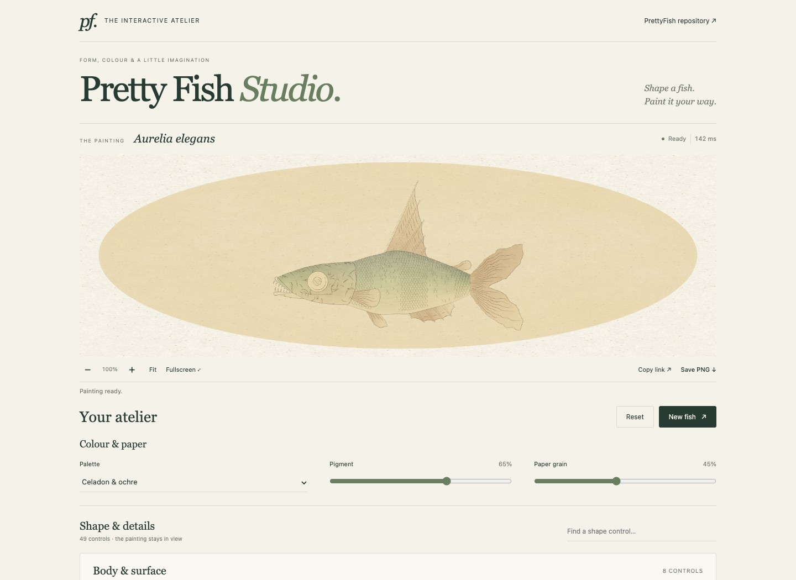

# Pretty Fish Studio

A painted fish at the top of the page, with **all 49 FrankFish shape controls**
below it, plus Pretty Fish's **palette, pigment and paper-grain controls**.

**[Open the interactive studio →](https://pretty-fish-studio.frankmarsman.chatgpt.site)**

[](https://pretty-fish-studio.frankmarsman.chatgpt.site)

The studio combines [FrankFish Fast](https://github.com/FrankMarsman/FrankFish)
with painting routines adapted from LingDong Huang's
[nonflowers](https://github.com/LingDong-/nonflowers). The original copyright
and complete MIT notices are preserved in [`dist/licenses/`](dist/licenses/).

## Using the studio

- Change any slider, switch or style selector to update the painting. The fish
  remains visible as you scroll through the controls.
- Adjust palette and pigment without regenerating anatomy. Paper grain changes
  only the cached background; its pattern stays fixed while the fish changes.
- A warm ochre oval frames the fish against lighter paper, inspired by
  nonflowers. Fit keeps the entire specimen inside it; PNG exports include it.
- **New fish** changes proportions and seed, keeping your style and painting
  choices. **Reset** restores the defaults, keeping the current seed.
- Edit the specimen seed to change random details while keeping proportions.
- **Copy link** saves every shape and painting setting. **Save PNG** exports
  the painting. Zoom, pan, Fit and Fullscreen are available below the artwork.
- Search for a control or group to find it quickly.

The website is buildless static HTML/JS, with no runtime dependencies, API keys,
CDN assets or server-side generation.

## Run and test

Node.js 20+ and Google Chrome are used by the development checks:

```sh
npm ci
npm run dev
# http://127.0.0.1:4184
```

In another terminal:

```sh
npm run check
npm test
npm run test:browser
# Target just the forehead regression:
npm run test:head
```

Set `CHROME_PATH` if Chrome is installed somewhere other than the default macOS
location. Set `STUDIO_URL` to test another served copy. The browser test saves
screenshots and an exported PNG in ignored `artifacts/`.

## Why it responds quickly

The Fast generator runs in a worker, and compatible browsers paint there too.
Draft frames appear while a control is dragged, followed by a detailed final
frame. Pending work is coalesced to the latest requested state. Geometry, ink,
pigment transparency and paper each have separate caches.

Local Apple M1 / Node.js 24.1.0 measurements gave **12–15× faster geometry** than
the original generator across the four scale styles, with matching polylines.
The final browser drag check displayed **12 frames from 20 input events**,
with a **39.0 ms median dispatch-to-display time**. Queue wait and
the final-render debounce are excluded. Performance varies by fish and device.

[Generation measurements](docs/generation-performance.json) ·
[Painting measurements](docs/painting-performance.json) ·
[Browser verification](docs/browser-verification.json) ·
[Architecture and adaptation details](docs/ARCHITECTURE.md)

## Files

| File | Role |
| --- | --- |
| `dist/app.js` | All controls, request coalescing, sharing, zoom and PNG export |
| `dist/controls.js` | Complete original FrankFish control catalogue |
| `dist/state.js` | Validation, discrete values and complete shareable state |
| `dist/render-worker.js` | Fast anatomy, region extraction, geometry cache and painting |
| `dist/painter.js` | Nonflowers washes, cached pigment/ink and fixed paper |
| `dist/vendor/frankfish-fast.js` | Fast upstream generator with scoped region adapter |
| `dist/vendor/nonflowers.js` | Adapted original noise, colour, stroke and paper primitives |

## Deploy

Serve `dist/` with any static host. The `.openai/hosting.json` manifest binds this
standalone studio to its own Site; the original Pretty Fish website is separate.
No build is required.

## Credits

FrankFish Fast: FrankMarsman's optimised version of fishdraw.
Original fishdraw: © 2021 Lingdong Huang, MIT.
Original nonflowers: © 2018 Lingdong Huang, MIT.
Studio integration, interface and tests: © 2026 Pretty Fish contributors, MIT.
