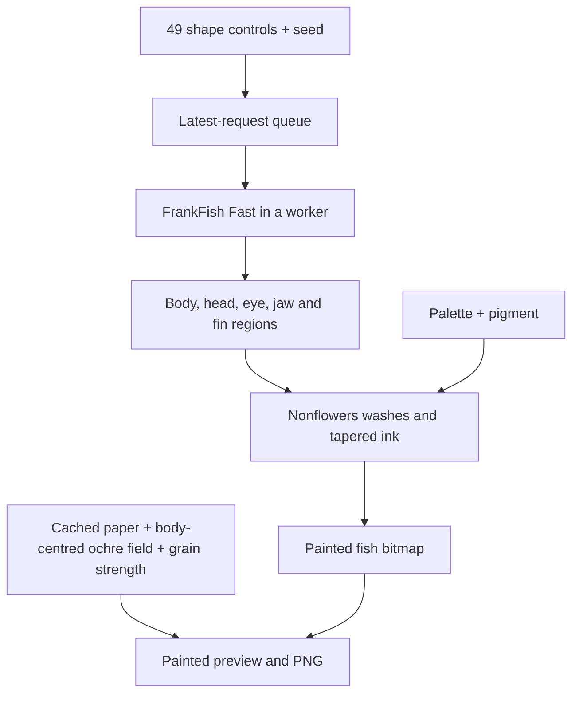

# Pretty Fish Studio

The runtime uses **FrankFish Fast**, from `FrankMarsman/FrankFish`'s
`FishDraw_Fast.js` (Git blob `214ead3b551ec7c23116e06080d9dcce0da3c775`).
Its prepared-edge clipping and polygon-union optimizations are retained.

`dist/controls.js` preserves all 49 controls and their exact choices from
FrankFish's `demo/src/controls.js` (Git blob
`69baa29254c1005b067fa2a393b3e3d2f7870309`).

## Flow

The preview shows only a painting. Runtime assets contain no original slow
fishdraw engine. Unmodified original and Fast source files are retained under
`tests/fixtures/` for compatibility tests and the generation benchmark, and are
excluded from the deployed static directory.

## Anatomy adapter

`fish(params, {regions: true})` returns the same polylines as upstream plus
anatomical regions and grouped detail paths. `fish(params)` keeps the original
flat-array API. Head fill geometry is captured separately from its clipping mask. The body also
retains that extended head mask as a cutout. Both its colour wash and extra
outline strokes subtract the cutout, so the generic body envelope cannot shade
the empty area outside the forehead.
The only correctness repair in the copied source is declaring the original
`lip1s` local, allowing the generator to be scoped in strict mode.

`sceneFor(seed, params)` resets the original RNG and Perlin table on every
request, following FrankFish's worker semantics. It clones parameters before
calling the generator because head construction may clamp eye size internally.
Requested control values are preserved separately for sharing and the interface.

## Rendering and responsiveness

- One request runs at a time; at most one newer request is retained. Intermediate
  completed frames remain visible while dragging, then the newest requested
  state receives a detailed final render after input settles.
- Supported browsers generate geometry **and paint on an OffscreenCanvas worker**.
  A geometry-worker/main-canvas fallback supports browsers without OffscreenCanvas.
- Appearance changes reuse the most recent geometry. Changing grain updates
  only the background and requires neither geometry nor fish repainting.
- A stable 600 × 360 alpha texture is computed once from nonflowers' original
  `fade` and `wispy` operations. Canvas applies it as a destination-in mask. The
  alpha fields are reused; the palettes supply the pigment colour.
- Body washes adapt nonflowers' coloured-ribbon quadrilaterals. Fins use
  root-to-tip washes, heads have separate shading, and detail paths use the
  original variable-width polygon stroke routines.
- Ink geometry is cached for the current fish at draft and final resolutions;
  palette changes recolour its alpha mask.
- The paper master is generated once with a seed independent of fish anatomy.
  Grain strength interpolates that same master. Neither moving a slider nor
  choosing a new fish reseeds it.
- The body polygon's area centroid anchors the camera at the centre of the
  artwork; fin and tail extensions cannot pull that anchor off-centre.
  A superellipse (exponent 3.5) fits all painted outlines and ink points with
  padding based on body height. Its width follows the fish rather than filling
  the page, and its flatter curves reduce empty horizontal space.
- A separate canvas holds the ochre wash. Only its shape mask follows anatomy;
  the seeded wash texture is sampled at fixed paper coordinates. Paper grain
  stays on its own unchanged layer. Both are retained in PNG exports, and
  neither is regenerated or reseeded when a shape control changes.
  Framing is cached for draft and final sizes. The field stays still during zoom/pan.
- Zoom and panning are presentation transforms, so they do not regenerate a fish.
  PNG export composites the same paper, fish and view transform.

The original nonflowers colour-channel fluctuations are not read back and
recomputed per pixel on every frame. Its alpha variation, paper, strokes and
colour interpolation are retained in an adapted renderer. This trades an
expensive pixel pass for cached textures while preserving the painted appearance.

## State and controls

All shared parameters are normalised to FrankFish's original control values.
Links include all 49 parameters, seed, palette, pigment and paper strength.
Malformed links safely fall back to a new specimen. Unicode seeds are supported.
New fish keeps categorical style choices and painting settings; Reset restores
shape and painting defaults while preserving the seed.

Dependent length controls remain visible but are disabled when their associated
feature is off. Search filters control names and groups. The painted preview
stays at the top while the page scrolls.

## Verification

- `npm test` checks all 49 parameters, every categorical choice and slider
  extreme (109 boundary/choice cases plus 10 compound profiles), seeded anatomy, upstream Fast geometry parity,
  parameter validation and share-link round trips.
- `npm run test:browser` checks every control, a continuous drag, latest-state
  delivery, independent paper, geometry caches, palettes, PNG downloads,
  share replay, randomisation, reset, Unicode, search, zoom, sticky preview,
  mobile widths and the non-OffscreenCanvas fallback.
- `npm run benchmark` compares the unmodified original and Fast algorithms with
  matching geometry, isolated function closures and identical seed/parameters.
- `node tools/benchmark-paint.cjs` compares the original Pretty Fish painter with
  the cached studio painter on identical scene geometry and output sizes.

The checked results live in `docs/`. Timings depend on fish, browser and device;
these are local measurements, not fixed response-time guarantees.
